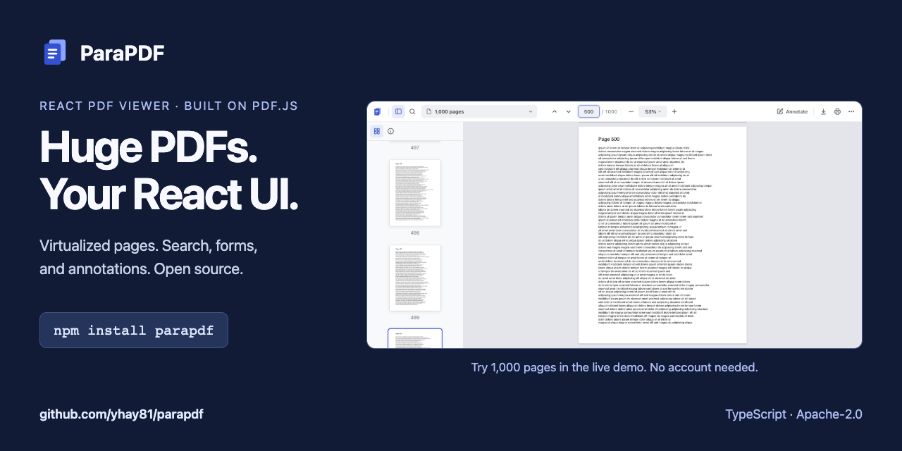

# ParaPDF

A fast, customizable **React PDF viewer for huge documents**, built on
[pdf.js](https://github.com/mozilla/pdf.js). Virtualized pages, text selection,
search, forms, and annotations, with your own React UI.

[**Try 1,000 pages →**](https://parapdf.yhay81.com/demo/?file=synthetic-text-1000.pdf)
· [Documentation](https://parapdf.yhay81.com/getting-started/)
· [Performance](https://parapdf.yhay81.com/about/performance/)
· [npm](https://www.npmjs.com/package/parapdf)

[](https://parapdf.yhay81.com/demo/?file=synthetic-text-1000.pdf)

The demo needs no account. Try the
[1,000-page document](https://parapdf.yhay81.com/demo/?file=synthetic-text-1000.pdf),
a [fillable form](https://parapdf.yhay81.com/demo/?file=f1040.pdf), or
[Japanese text](https://parapdf.yhay81.com/demo/?file=mhlw-doc.pdf).
You can also open your own PDF; the demo reads it locally in your browser.

## Start with two components

Requires React and React DOM 19.3 or later.

```bash
npm install parapdf
```

```tsx
import { PdfDocument, PdfViewer } from "parapdf";

export function App() {
  return (
    <PdfDocument source="/manual.pdf">
      <PdfViewer style={{ height: "100vh" }} />
    </PdfDocument>
  );
}
```

Give the viewer a definite height and serve a PDF at the source URL.
ParaPDF ships pdf.js's worker and assets; Vite, webpack, Rsbuild, and
Next.js emit them with your build. See
[bundler setup](https://parapdf.yhay81.com/setup/bundlers/) for other bundlers.

You build the toolbar and surrounding UI. The
[controls guide](https://parapdf.yhay81.com/guides/controls/) shows how.

> **Status: 0.x.** The API may change in any minor release until 1.0.
> The [documentation site](https://parapdf.yhay81.com) follows the published
> npm package; `main` may contain unreleased API changes. See the
> [changelog](CHANGELOG.md) and [limitations](https://parapdf.yhay81.com/about/limitations/).

## Why not just react-pdf?

[react-pdf](https://github.com/wojtekmaj/react-pdf) gives applications
`Document` and `Page` components. Its
[FAQ](https://github.com/wojtekmaj/react-pdf/wiki/Frequently-Asked-Questions#rendering-pdf-is-too-slow-what-can-i-do)
recommends virtualization for large documents. Our comparison adds
react-window to do that, so both viewers mount only a window of pages.

ParaPDF needs more than a limit on mounted pages: huge PDFs also need
control over which pages draw first, how much canvas memory they hold,
and what happens when the reader zooms or returns to a page. For example,
[react-pdf 11.0.0 releases a page's canvas when it unmounts](https://github.com/wojtekmaj/react-pdf/blob/v11.0.0/packages/react-pdf/src/Page/Canvas.tsx),
so remounting draws it again. Adding a shared canvas cache and drawing
policy would require more viewer infrastructure around those components.

ParaPDF provides that infrastructure on top of the same pdf.js engine:

- **React stays out of the hot path.** Scrolling and zooming commit no React
  state per frame, and pixels never pass through React.
- **Huge documents, bounded rendering.** Pages outside a small window
  unmount. Visible pages get drawing priority: a quick base first and full
  resolution once scrolling settles. At high zoom, only the visible region
  gets full detail within the canvas budget.
- **Keep work for a return visit.** Unmounted pages retain their canvases
  within a shared budget. Returning to a page whose canvases are still
  cached reuses those pixels without drawing them again.
- **Viewers of their own.** Several viewers and thumbnails share one open
  document, each with its own position, zoom, rotation, and layout.
- **A document viewer.** Selectable, accessible text, search, links and the
  outline, forms, annotations, printing, saving, layers, attachments, and
  encrypted documents. Each feature is a module only applications using it
  load.
- **Your interface.** Compose controls, form state, and selection with React
  instead of building a bridge to an iframe.

## Performance, with the trade-offs

In a **1,000-page** comparison of ParaPDF **0.9.0** with
**react-pdf + react-window**, ParaPDF made **about 42% fewer React commits**
and held **about 55% less estimated canvas memory** at the sampling point.

Both viewers virtualized pages. Conditions: 3,600 CSS px/s for four seconds
from the beginning of the document, five runs, medians, Chromium
158.0.8127.18 on an Apple M2 Pro, 1280×900 at devicePixelRatio 2,
November 16, 2026. The comparison used react-pdf 11.0.0 and react-window 2.5.3.

| Measurement | ParaPDF | react-pdf + react-window |
| --- | ---: | ---: |
| First paint | 162 ms | 180 ms |
| React commits during the scroll | 25 | 43 |
| Estimated canvas memory at the sample | 111 MiB | 249 MiB |
| Main-thread blocked time during the scroll | 51 ms | 17 ms |

**ParaPDF blocked the main thread longer in this condition.** Across all
12 document/speed/browser conditions, it committed React less often and
held fewer canvas pixels at the sample, while blocked time varied.

First paint can be a low-resolution base. Canvas memory counts pixels,
including retained canvases, after scrolling and visible blanks have filled;
it does not wait for full refinement and is not total browser memory.
Scroll-time blocking excludes work deferred until scrolling stops.
The stacks use different pdf.js versions (6.5.438 and 6.3.289).
[All three browsers, individual runs, limitations, and reproduction steps](examples/prototype/results/compare-react-pdf-20261116.md)
are recorded with the exact source commit. Playwright WebKit is not Safari.

## Help shape it

If ParaPDF would be useful in your app, **star this repository to find it
again**. Tried it with a real document? A
[bug report](https://github.com/yhay81/parapdf/issues/new?template=bug_report.yml)
or [feature request](https://github.com/yhay81/parapdf/issues/new?template=feature_request.yml)
helps decide what to work on next. Share only documents you are allowed to
make public; see [security reporting](SECURITY.md) for vulnerabilities.

The name combines the Japanese "parapara", flipping quickly through pages,
with parallel rendering on worker threads.

## Develop it

A pnpm workspace for Node 24 or later: the package in
[`packages/parapdf`](packages/parapdf), the demo with its functional checks
and benchmarks in [`examples/prototype`](examples/prototype), the engine
benchmark in [`bench`](bench), and the documentation site in [`site`](site).
[`docs/architecture.md`](docs/architecture.md) describes the design,
[`AGENTS.md`](AGENTS.md) the layout and commands,
[`CONTRIBUTING.md`](CONTRIBUTING.md) what a pull request needs, and
[`SECURITY.md`](SECURITY.md) how to report a vulnerability.

```bash
pnpm install
pnpm check
pnpm test
pnpm --filter @parapdf/bench exec playwright install chromium webkit firefox
pnpm --filter @parapdf/bench corpus
pnpm --filter @parapdf/prototype build
ENGINE=pdfjs pnpm --filter @parapdf/prototype check:text
```

## License

[Apache License 2.0](LICENSE). Parts of ParaPDF are derived from pdf.js:
see [NOTICE.md](NOTICE.md).
